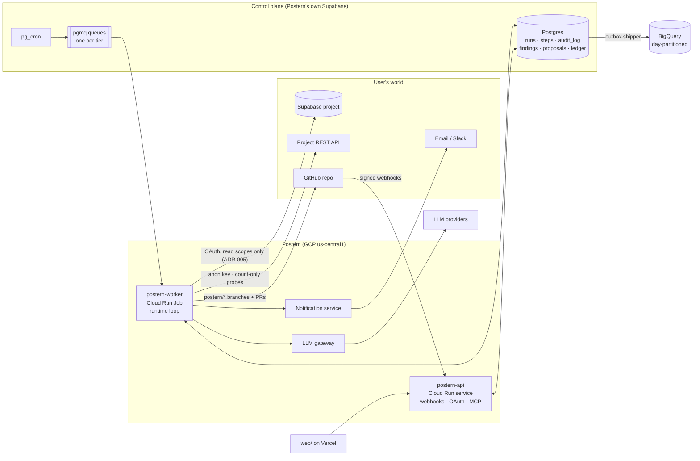

# Postern architecture

**Status:** Phase 1 (infrastructure as code). Each phase updates this file.

## What exists now

| Piece | State |
|---|---|
| GCP project `postern-prod-8ybj`: state bucket, APIs, Artifact Registry, service accounts, secret placeholders, `postern-api`, `postern-worker`, BigQuery `postern` (7 tables + dedup views), WIF, ₹100 budget | Applied 2026-10-13; `terraform plan` shows no drift |
| Postern's own Supabase project `postern-control` (ref `bpymxbzldxhsqrvrybyo`, us-east-1, org `postern`) | Applied 2026-10-13, SSL enforced |
| pgmq 1.5.1 and pg_cron 1.6.4 on `postern-control` (Postgres 17.11) | Migration `20261013000000_enable_pgmq_and_pg_cron.sql` pushed; queues not exposed through the Data API |
| `postern-api` | FastAPI, `GET /health` only |
| `postern-worker` | Logs one structured "hello" line and exits |
| CI/CD | `ci.yml`: checks and image build on every PR; on `main`, deploy via WIF with a smoke test |

**Identities and secrets** (`infra/terraform/gcp/secret_access.json` is the single source):

| Service account | Can read | Other grants |
|---|---|---|
| `postern-api` | supabase-oauth-client-secret, github-webhook-secret, token-encryption-key, control-plane-db-url-api | none |
| `postern-worker` | llm-api-key, control-plane-db-url-worker | BigQuery dataEditor on dataset `postern` |
| `postern-deployer` | none | Artifact Registry writer (repo), Cloud Run developer (project), actAs api and worker; impersonable only from `ci.yml` on `main` |

`github-app-private-key` and `resend-api-key` have no reader until the Tier 1 and Tier 2
components get their own service accounts (Phases 5 and 6).

The rest of this document describes the target system.

## Components

## Request paths

- **Nightly check.**
  1. `pg_cron` enqueues a run per connected project. The run row, audit row and queue message
     commit together (ADR-002).
  2. The worker dequeues it, re-checks the registry, and runs the agent loop (ADR-001).
  3. Advisor lints and probe counts become findings deterministically. The model explains and
     groups them.
  4. Every step is checkpointed and audit-logged in the same transaction.
- **Fix.**
  1. The Fix Drafter writes a migration, which passes the SQL gate.
  2. It's validated in an isolated validator Job (ADR-007).
  3. On repos whose default branch GitHub protects (ADR-006), the Drafter pushes to
     `postern/*` and opens a PR, and a human merges. Everyone else gets reviewed SQL and
     steps.
  4. A re-probe verifies the exposure is closed.
- **Contact.** Every message to a user goes through the notification service, which enforces
  the per-person budget, quiet hours and dedupe.
- **Analytics.** Events are written to a Postgres outbox with the state change. A shipper
  appends them to BigQuery through the Storage Write API, and views deduplicate on `event_id`
  (ADR-003).

## Trust boundaries and safety

The threat model ([threat-model.md](threat-model.md)) is the source of truth. In short:

- **Credentials can't write.** OAuth uses four read scopes (no `secrets:*`, no `auth:read`),
  plus the public anon key for probes. The GitHub App is limited to `postern/*`, with no `workflows` permission.
- **Code gates sit where credentials can't reach:** the policy gate on every tool call, the SQL
  gate on drafted migrations, the push gate on refs and paths, and the statement allowlist on
  read-only SQL.
- **The database enforces what code might forget:** unique idempotency keys, the run state
  machine, the append-only hash-chained audit log, RLS on every table, and notification
  budgets.

## Decisions

| ADR | Decision |
|---|---|
| [ADR-001](adr/ADR-001-agent-runtime.md) | Thin custom agent loop, with LiteLLM only inside the gateway |
| [ADR-002](adr/ADR-002-queue.md) | pgmq in Postern's Supabase Postgres, one queue per tier |
| [ADR-003](adr/ADR-003-warehouse-ingestion.md) | BigQuery Storage Write API fed by a Postgres outbox |
| [ADR-004](adr/ADR-004-no-row-values-in-prompts.md) | Row values never reach an LLM prompt |
| [ADR-005](adr/ADR-005-supabase-oauth-scopes.md) | Scopes: `projects:read`, `database:read`, `rest:read`, `storage:read`, plus a client-side endpoint allowlist |
| [ADR-006](adr/ADR-006-github-fixes-on-protected-repos.md) | Fix PRs only on repos where GitHub enforces a non-bypassable review ruleset |
| [ADR-007](adr/ADR-007-fix-validation-runtime.md) | Validation in a self-contained validator image on its own Cloud Run Job (no Docker, secrets or egress), with a spike first |
| [ADR-008](adr/ADR-008-test-environment.md) | Two free projects in separate orgs: `postern-control` and a `testbed` with planted and clean tables |
| [ADR-009](adr/ADR-009-license.md) | Apache-2.0 |
| [ADR-010](adr/ADR-010-infrastructure-and-deploy-ownership.md) | Three Terraform roots; Terraform owns shape, CI owns images (Proposed) |

Still open: what starts the worker Job (ADR-002 consequences, Phase 1–2).
